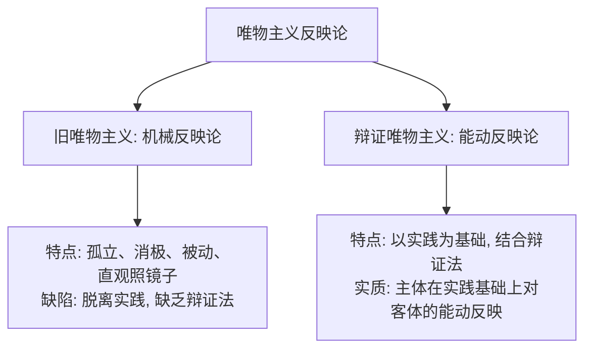

# 考研政治背诵手册带背笔记 · Day 04

- **录音时间**：10月13日
- **主讲老师**：韩雪老师
- **对应范围**：
  - [专题 10] 实践（书内第 19—22 页）
  - [专题 11] 认识的本质（书内第 22—23 页）
  - [专题 12] 认识的两次飞跃以及实践与认识的辩证运动（书内第 23—25 页）
- **对应专题 PDF**：
  - [专题10-实践.pdf](../pdf/01-马克思主义基本原理/专题10-实践.pdf)
  - [专题11-认识的本质.pdf](../pdf/01-马克思主义基本原理/专题11-认识的本质.pdf)
  - [专题12-认识的两次飞跃以及实践与认识的辩证运动.pdf](../pdf/01-马克思主义基本原理/专题12-认识的两次飞跃以及实践与认识的辩证运动.pdf)

---

## 模块一 · 专题 10 实践（书 P19—P22）

> **实践的定义**：实践是**人类能动地改造世界的客观物质性活动**。

### 1. 实践的三大基本特征
1. **客观实在性（直接现实性 · 最根本特征）**：
   - 实践的主体、客体、中介工具以及实践的过程和结果，全部都是**客观实在的物质力量**。
   - ⚠️ 考点：实践能够把“观念中的存在”变成“现实中的存在”，具有**直接现实性**（这是意识所不具备的！）。
2. **自觉能动性**：
   - 实践是有目的、有计划、有意识的活动，区别于动物无目的的本能活动。
3. **社会历史性**：
   - 实践不是单个孤立人的孤立活动，而是处于一定社会关系中的人的活动；
   - 实践的范围、水平和方式随**历史条件的变化而发展演进**。

---

### 2. 实践对认识的决定作用（四大维度 · 单选高频）

| 决定作用维度 | 考点提炼与做题眼 | 经典干扰选项排雷 |
| :--- | :--- | :--- |
| **实践是认识的来源** | 实践是认识的**唯一最终源泉**。 一切真知都来源于实践。 | ❌ “认识只能来源于个人的直接经验” （正解：来源唯有实践，但学习者的获得途径有二：**直接经验**与**间接经验**，读书学习是获取间接经验的重要途径）。 |
| **实践是认识发展的动力** | 1. 实践不断提出新课题、新需求； 2. 实践提供日益完备的认识工具和技术手段； 3. 实践锻炼和提高主体的思维认识能力。 | ❌ “认识发展的根本动力是科学理论的自我演进” （正解：根本动力是**社会实践**）。 |
| **实践是认识的目的** | 认识的目的不是为了将理论束之高阁，而是为了**回到实践中指导实践、改变世界**。 | - |
| **实践是检验真理的唯一标准** | 唯有实践能够跨越主观与客观的界限，将主观认识与客观现实进行对照。 | ❌ “逻辑证明是检验真理的标准” （正解：实践是唯一标准，逻辑证明只能起到补充作用）。 |

---

## 模块二 · 专题 11 认识的本质（书 P22—P23）

### 1. 两条根本对立的认识路线
- **唯物主义反映论**：从“物到感觉和思想”（坚持物质第一性，反映存在 ✔️）。
- **唯心主义先验论**：从“思想和感觉到物”（把认识看作先于物质、先于经验的主观自生之物 ❌）。

### 2. 两种唯物主义反映论的本质区别（高频考点）

- **定论**：马克思主义认识的本质 —— **主体在实践基础上对客体的能动反映**。
  - 能动反映的两个特征：**摹写性（反映客观真实）** 与 **创造性（加工与建构）**。

---

## 模块三 · 专题 12 认识的两次飞跃（书 P23—P25）

### 1. 第一次飞跃：从感性认识到理性认识

| 阶段 | 地位与形式 | 反映特点与对象 |
| :--- | :--- | :--- |
| **感性认识** | **初级阶段** 三种形式：**感觉、知觉、表象** | 反映事物的**外部联系、表面现象**；通过感官直接感知，具体、生动。 |
| **理性认识** | **高级阶段** 三种形式：**概念、判断、推理** | 反映事物的**内在联系、本质规律**；通过抽象思维把握，抽象、深刻。 |

- **飞跃的必备条件**：
  1. 深入实践，获取十分丰富且合乎实际的感性材料；
  2. 运用科学思维方法对感性材料进行加工制作（**“去粗取精、去伪存真、由此及彼、由表及里”**）。

---

### 2. 理性因素 vs 非理性因素（书 P24 核心辨析）
- **理性因素**：人的理性直观、理性思维能力。
  - **作用**：在认识过程中起**主导、解释、规范**作用。
- **非理性因素**：
  - 范围：联想、想象、直觉、灵感，以及情感、意志、欲望等。
  - **作用**：起**激活、驱动、诱导**作用。
  - ⚠️ 排除干扰项：非理性因素对认识活动具有重大推动或阻碍作用，但**绝不决定认识的内容与方向**！

---

### 3. 第二次飞跃：从理性认识到实践（更具决定意义的飞跃！）
- **为什么第二次飞跃比第一次飞跃更重要？**
  1. **认识的目的在此实现**：认识世界的目的是为了改造世界；
  2. **认识的真理性在此检验**：理性认识是否正确，必须回到实践中去检验和发展。

---

## 模块四 · 课后排雷与经典干扰项清单

| 经典干扰选项 | 诊断判定 | 老师正解分析 |
| :--- | :---: | :--- |
| “实践的直接现实性与意识的能动性具有相同的作用机制” | ❌ 错误 | 唯有**实践**具有直接现实性，意识只能通过实践转化为客观现实。 |
| “读书获取的知识不是来源于实践” | ❌ 错误 | 读书是获取**间接经验**，其最初源头依然是人类的社会实践。 |
| “旧唯物主义与辩证唯物主义都坚持了能动的反映论” | ❌ 混淆 | 旧唯物主义是**消极、直观、被动的反映论**，只有辩证唯物主义是**能动反映论**。 |
| “理性认识高于感性认识，所以感性认识不重要” | ❌ 片面 | 理性认识依赖于感性认识，感性认识有待于发展为理性认识。 |
| “直觉和灵感等非理性因素在认识过程中起主导决定作用” | ❌ 错误 | 起**主导作用的是理性因素**，非理性因素起激活和驱动作用。 |

---

## 模块五 · 课后“找原理”演练

- **典型辨析材料**：
  - 科学家进行实验探索、由观察表象到提炼物理定律，并最终应用到工程技术产品中。
- **对应哲学考点**：
  - 实践是认识的基础（来源、动力、目的与检验标准）；
  - 认识运动的两次飞跃：感性认识到理性认识（抽象与提炼）、理性认识到实践（指导工程应用）；
  - 辩证唯物主义认识论是主体在实践中对客体的能动反映。
