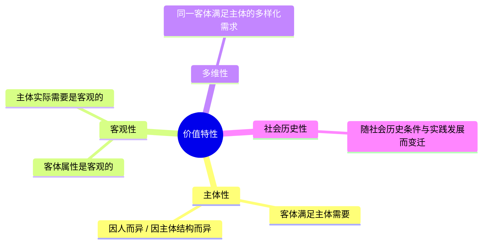

# 考研政治背诵手册带背笔记 · Day 05

- **录音时间**：10月14日
- **主讲老师**：韩雪老师
- **对应范围**：
  - [专题 13] 真理（书内第 25—27 页）
  - [专题 14] 价值（书内第 27—30 页）
  - [专题 15] 认识世界和改造世界（书内第 30—31 页）
- **对应专题 PDF**：
  - [专题13-真理.pdf](../pdf/01-马克思主义基本原理/专题13-真理.pdf)
  - [专题14-价值.pdf](../pdf/01-马克思主义基本原理/专题14-价值.pdf)
  - [专题15-认识世界和改造世界.pdf](../pdf/01-马克思主义基本原理/专题15-认识世界和改造世界.pdf)

---

## 模块一 · 专题 13 真理（书 P25—P27）

> **真理的定义**：真理是标志主观与客观相符合的哲学范畴，是人们对于客观事物及其规律的**正确反映**。

### 1. 真理的客观性（最根本属性）
- **真理是客观的（客观真理）**：
  - 真理的内容是客观的（来自客观世界及规律）；
  - 检验真理的标准是客观的（社会实践）。
- **唯物主义真理一元论**：
  - 在同一时间、同一地点、同一条件下，对同一客观对象的真理性认识**只有一个**，不存在多元真理。

---

### 2. 真理的绝对性与相对性（真理的二重性）

| 维度 | 核心含义与表现 | 错误倾向（警惕命题陷阱） |
| :--- | :--- | :--- |
| **真理的绝对性** （绝对真理） | 1. 任何真理都包含不依赖于人的客观内容（承认真理客观性即承认真理绝对性）； 2. 人类思维按其本性能够认识无限发展的物质世界（世界可知）。 | **绝对主义（教条主义）**： 把真理神化，视为凝固不变、一劳永逸的教条。 |
| **真理的相对性** （相对真理） | 1. 广度有限：任何真理只是对无限物质世界某一部分的正确反映； 2. 深度有限：只是对特定事物近似正确的反映，有待深化。 | **相对主义（怀疑论/诡辩论）**： 否认客观真理的存在，把真理相对性夸大为主观随意。 |

- **辩证关系**：
  - **绝对之中有相对**，任何真理都是走向绝对真理的一个过程；
  - **相对之中有绝对**，无数相对真理的总和构成绝对真理。

---

### 3. 真理与谬误（对立统一）
- **对立性（严格界限）**：
  - 在确定的对象和范围内，真理与谬误是严格对立的，对就是对，错就是错，原则界限不可混淆。
- **统一性（相互转化）**：
  - **真理是有条件的、具体的**！
  - ⚠️ 考点：任何真理都有其适用的范围和条件，**超出特定的范围和条件，真理就会变成谬误**。
  - *老师生动例证*：在欧式平面几何中，“三角形内角和等于 180 度”是绝对真理；但若超出平面范围，放到凸球面（内角和>180度）或凹双曲面（内角和<180度）上，曾经的真理就变成了谬误。

---

## 模块二 · 专题 14 价值（书 P27—P30）

> **定义**：哲学上的价值，是揭示**客体满足主体需要**的效益关系。

### 1. 价值的四大特性

---

### 2. 价值 vs 价值评价（高频核心考点 · 老师连讲三遍）
- **价值是客观的**：
  - 事物的客观属性与主体的实际生存发展需要之间的效益关系是不以人的意志为转移的（*老师生动例证*：这味药到底能不能治愈某种病，药效关系是客观存在的）。
- **价值评价是主观的**：
  - 价值评价是主体对客观价值的认识与评判（患者或医生认为药是否管用、对药效的主观评价）。
- **科学评价的标准**：
  - 必须坚持以客观规律为基础；
  - 最终以**人民群众的利益和要求**为最高评价尺度。

---

## 模块三 · 专题 15 认识世界和改造世界（书 P30—P31）

### 1. 实践运行的双重尺度：真理尺度 vs 价值尺度

| 实践尺度 | 哲学要求 | 做题关键词 |
| :--- | :--- | :--- |
| **真理尺度** | 实践必须遵循客观事物的规律办事情。 | **合规律性**（客观、科学、实事求是） |
| **价值尺度** | 实践必须按照人类自身的需要和目的办事情。 | **合目的性**（满足人的利益、以人为本） |

- **结论**：任何成功的实践，都必须是**真理尺度与价值尺度的统一（合规律性与合目的性的辩证统一）**。

---

### 2. 认识与实践的高级目标：从必然走向自由
- **必然**：客观事物内在的、本质的、不以人的意志为转移的发展规律。
- **自由**：是对必然的**认识**和对客观世界的**改造**。
- ⚠️ **红线排雷**：
  - **自由绝不是随心所欲摆脱客观规律！**
  - 人不能消除或违背必然性，只有在**充分认识必然、利用必然**的前提下，才能获得真正的自由。

---

## 模块四 · 课后排雷与经典干扰项清单

| 经典干扰选项 | 诊断判定 | 老师正解分析 |
| :--- | :---: | :--- |
| “真理的客观性意味着真理本身就是客观事物” | ❌ 混淆 | 真理是**认识**（主观形式），但其**内容与检验标准是客观的**。 |
| “真理与谬误没有不可逾越的鸿沟，二者随时可以相互转化” | ❌ 忽略条件 | 转化必须**在一定条件下**（如超出适用范围），在确定范围内二者界限分明。 |
| “价值是主观的，所以仁者见仁、智者见智” | ❌ 混淆概念 | **价值是客观的**，主观的是对价值的**“价值评价”**。 |
| “自由意味着人类能够超越客观必然性对人的束缚” | ❌ 错误 | 自由是**对必然的认识和利用**，永远无法摆脱或消灭规律本身。 |
| “实践的成功只要满足人类自身利益（合目的性）即可” | ❌ 片面 | 必须同时满足**合规律性（真理尺度）**与**合目的性（价值尺度）**。 |

---

## 模块五 · 课后“找原理”演练

- **典型辨析材料**：
  - 科技研发既要探索自然客观法则（如空间物理），又要造福全人类福祉；科学理论随着航天实践从地球引力场扩展到深空引力场。
- **对应哲学考点**：
  - 认识的真理尺度与价值尺度的有机统一；
  - 真理是具体的、有条件的，真理在实践发展中不断由相对走向绝对；
  - 认识世界与改造世界：人类通过把握客观规律从必然王国迈向自由王国。
