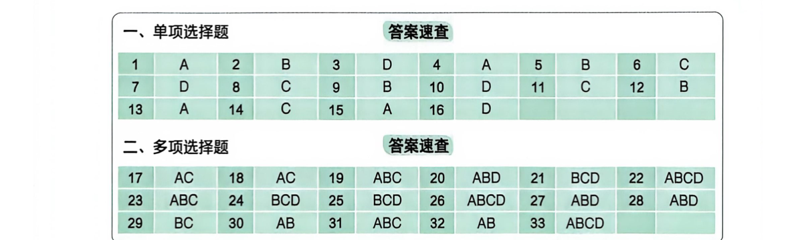

# 肖八第8套：选择题参考答案

[返回答案目录](README.md) · [查看原题](../md/x8-08.md) · [返回肖八总入口](../README.md)

来源：《27肖八答案及解析-完整版.pdf》PDF第78页“答案速查表”（物理页码）。转写后已逐项对照原表核对；未收录解析和分析题。

展开单项选择题答案（1—16）

| 题号 | 答案 |
| --- | --- |
| 1 | A |
| 2 | B |
| 3 | D |
| 4 | A |
| 5 | B |
| 6 | C |
| 7 | D |
| 8 | C |
| 9 | B |
| 10 | D |
| 11 | C |
| 12 | B |
| 13 | A |
| 14 | C |
| 15 | A |
| 16 | D |

展开多项选择题答案（17—33）

| 题号 | 答案 |
| --- | --- |
| 17 | AC |
| 18 | AC |
| 19 | ABC |
| 20 | ABD |
| 21 | BCD |
| 22 | ABCD |
| 23 | ABC |
| 24 | BCD |
| 25 | BCD |
| 26 | ABCD |
| 27 | ABD |
| 28 | ABD |
| 29 | BC |
| 30 | AB |
| 31 | ABC |
| 32 | AB |
| 33 | ABCD |

展开原PDF答案速查表截图

